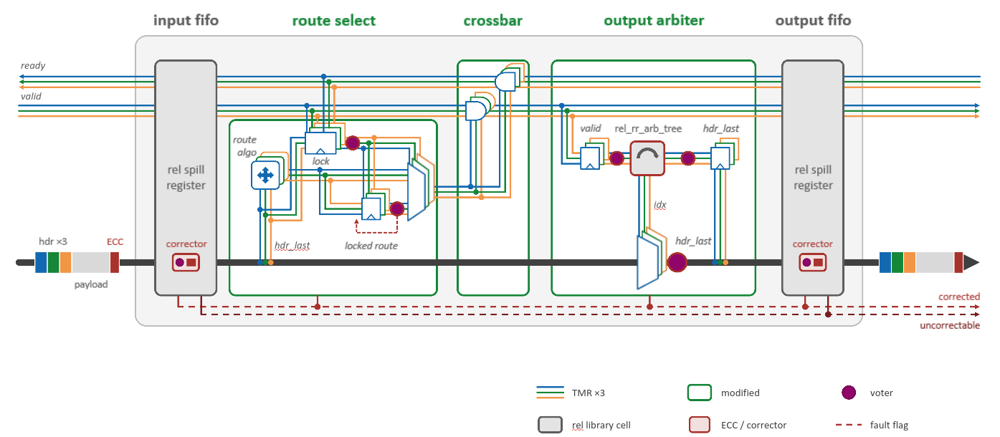

# relFlooNoC: a soft-error-tolerant FlooNoC

relFlooNoC is a fault tolerant version of [FlooNoC](https://github.com/pulp-platform/FlooNoC).
The goal of this project is to secure FlooNoC against single event upset and single event transient (SEU & SET).
With Hybrid protection the design is much more area efficient than a [fully TMR protected version](https://github.com/imchenwu/FlooNoC/tree/tmr).

This repo serves as a proof of concept, since the code is only implemented and tested for the basic FlooNoC setup and does not support variations like multicast, reduction etc... Also, the network interface is not protected.

Used **hybrid protection**:

- **TMR** protected:
   - Flit Header
   - Handshake signals (ready/valid)
   - Internal control signals (and FSM)
- **Hsiao SEC-DED (ECC)** protected:
   - Flit Payload

<div align="center">

</div>

relFlooNoC was developed as a semester thesis at the Integrated Systems Laboratory (IIS), ETH Zurich.
Everything that is not listed under [What is new](#what-is-new) is the original FlooNoC.

## What is new

### Redefinition of the flit type to **RelFlit**:

```
FlooNoC flit:  | header |  payload  |
RelFlit:       | header | header | header |  payload  | ECC |
```

### Network interface (here: chimney) setup:
The chimney serves as a translation from AXI4 to FlooNoC flit. On the FlooNoC side encoders and decoders are used to convert the flit to relflit. 

### relFlooNoC Router:
The Router can be split into five parts: 
```
input fifo -> route select -> crossbar -> output arbiter -> output fifo 
```

#### Fifo
The Fifos are placed inside wrappers "relfloo_stream_fifo_optimal_wrap". Inside, the actual fifo or spill register (rel_fifo,rel_spill_register) are taken from the redundancy cells from pulp. The remaining wrapping module (rel_stream_fifo) is locally made and triplicated following FlooNoC patterns.

The correctors (relfloo/relfloo_corrector.sv) are used for the spill registers. There are two modules, one for narrow and one for wide flit. Both can be configured individually see [Configuration](#configuration).

#### route select
All three routing algorithms are triplicated. Multicast is partially implemented (with the non-triplicated floo_route_xymask) but not tested. On the current state, the fault output signal of the FlipFlop of signal "route_sel_id_q" is connected to dummy wire, which allows optimization of this unused signal.

#### crossbar (relfloo/relfloo_router.sv line 348 - 430)
Simple TMR for all non payload signals. Multicast implemented but not tested

#### output arbiter
Used arbiter is the wormhole arbiter. There are two files in the repo for the two different design ideas for the transition between TMR and ECC. To be precise, how the triplicated arbiter index chooses the whole relflit for output.

1. relfloo/relfloo_wormhole_arbiter.sv:
   
   - Here, all input routes are triplicated. Each set goes over a MUX controlled by one copy of arb index. Afterwards, the three chosen relflit copies are voted bit by bit into one output flit.
   - Resources needed: 
      - $(3 \cdot \text{bit}(\text{relflit}))$  "5to1 MUX"
      - $(\text{bit}(\text{relflit}))$ "single bit TMR voter" (this also indicates the fault signals needed to be wired to output)

2. relfloo/relfloo_wormhole_arbiter_new.sv:
   
   - Here, the arb index is voted for every flit bit in advance. And then controls the MUX bit by bit. Note that the arb index has 3 bits.
   
   - Resources needed: 
      - $( \text{bit}(\text{relflit}))$  "5to1 MUX"
      - $(3 \cdot \text{bit}(\text{relflit}))$ "single bit TMR voter" (this also indicates the fault signals needed to be wired to output)

The module rel_rr_arb_tree is taken from the redundancy cells.

### FlipFlop (FF)
All FFs are protected with TMR and voting at the FF output. With feedback loop, the error gets corrected also on longer stay. The FFs are implemented using macros: TMRFF, TMRFFL defined in "floo_noc/registers.svh". There,  modules are called from file "relfloo/TMR_FF.sv"

## New files and folders
| Path | Content |
|---|---|
| `hw/relfloo/relfloo_nw_router.sv` | Narrow-wide relFlooNoC router (req, rsp and wide link) |
| `hw/relfloo/relfloo_router.sv` | Single-link router used inside it |
| `hw/relfloo/relfloo_nw_chimney.sv`, `relfloo_axi_chimney.sv` | Network interfaces with encoder and decoder |
| `hw/relfloo/relfloo_encoder.sv`, `relfloo_decoder.sv` | Flit ⇄ RelFlit |
| `hw/relfloo/relfloo_corrector.sv` | Header vote and payload correction |
| `hw/relfloo/rel_stream_fifo.sv`, `relfloo_stream_fifo_optimal_wrap.sv` | Protected buffers with corrector for spill register |
| `hw/relfloo/relfloo_*arbiter.sv`, `relfloo_route_*.sv` | Triplicated arbitration and route selection |
| `hw/relfloo/relfloo_wormhole_arbiter_new.sv` | Alternative output arbiter (vote index), not compiled |
| `hw/relfloo/TMR_FF.sv` | Self-repairing TMR registers (`rel_ff_tmr`, `rel_ffl_tmr`) |
| `hw/include/floo_noc/registers.svh` | `TMRFF` and `TMRFFL` macros |
| `hw/include/floo_noc/typedef.svh` | `RELFLOO_TYPEDEF_*` macros for the RelFlit types |
| `hw/floo_pkg.sv` | `ECC_BITS`, `ECC_BITS_WIDE` and RelFlit width functions (added) |
| `hw/synth/relfloo_synth_*.sv` | Synthesis wrappers |
| `hw/synth/floo_synth_params_pkg.sv` | Package `relfloo_synth_nw_pkg` with the synthesis parameters (added) |
| `hw/tb/tb_relfloo_*.sv`, `tb_floo_nw_router_fi.sv` | Testbenches |

The TMR voters and the Hsiao encoders/decoders come from a fork of [redundancy_cells](https://github.com/pulp-platform/redundancy_cells):
[RongGi/redundancy_cells](https://github.com/RongGi/redundancy_cells/tree/relfloonoc), branch `relfloonoc`, based on upstream commit 3c7c57e. Bender fetches it automatically.

## Getting started

Install the FlooNoC prerequisites (Bender, QuestaSim or VCS) as described in the [FlooNoC documentation](https://pulp-platform.github.io/FlooNoC/), then:

```sh
git clone https://github.com/RongGi/FlooNoC_Error_Tolerant.git
cd FlooNoC_Error_Tolerant
make compile-vsim
make run-vsim-batch TB_DUT=tb_relfloo_rob     # or run-vsim for the GUI
```

`tb_relfloo_rob` connects a relFlooNoC router to five AXI network interfaces and checks random reads and writes, including the AXI response order.

## Using relFlooNoC in your design

relFlooNoC modules are drop-in replacements for their FlooNoC counterparts, with three differences:

1. **Link types:** the links carry RelFlits. Define them with the `RELFLOO_` macros instead of the `FLOO_` ones, for example:

   ```systemverilog
   `RELFLOO_TYPEDEF_NW_CHAN_ALL(axi, req, rsp, wide, axi_narrow_in, axi_wide_in, AxiCfgN, AxiCfgW, hdr_t)
   `RELFLOO_TYPEDEF_NW_LINK_ALL(req, rsp, wide, req, rsp, wide)
   ```

   This gives `relfloo_req_t`, `relfloo_rsp_t` and `relfloo_wide_t`. `hw/synth/floo_synth_params_pkg.sv` (package `relfloo_synth_nw_pkg`) is a complete example.
2. **Router ID:** `relfloo_nw_router` takes its ID three times (`id_i[2:0]`), one per copy.
3. **Fault flags:** the router has an output `faults_o[1:0]`:
   - `faults_o[0]` *corrected*: a voter saw a mismatch or a corrector fixed a bit,
   - `faults_o[1]` *uncorrectable*: a corrector found a double-bit error.

Connect a relFlooNoC network interface only to relFlooNoC routers, since the RelFlit only exists between them.

### Configuration

| Setting | Where | Default |
|---|---|---|
| Check bits per payload word, narrow links | `ECC_BITS` in `hw/floo_pkg.sv` | 8 (words of up to 120 bits) |
| Check bits per payload word, wide link | `ECC_BITS_WIDE` in `hw/floo_pkg.sv` | 8 |

Fewer check bits mean shorter words and fewer uncorrectable double errors, at the cost of more check bits in total (7 → up to 57 bits per word, 9 → up to 247).
The buffers are protected for a depth of two (spill registers), the FlooNoC default.

## Synthesis

The wrappers `relfloo_synth_nw_router` and `relfloo_synth_nw_chimney` (Bender target `floo_synth`) instantiate the router and network interface with the parameters of `relfloo_synth_nw_pkg`. Use them like the FlooNoC synthesis wrappers.
Make sure the redundancy survives the synthesis.

## Limitations

- The network interface itself is not protected, only its encoder and decoder.
- Only the second buffer slot is scrubbed. Two errors in the same word of a flit in the first slot are detected only further down the path.
- The fault outputs of the decoders in the network interface are not connected yet.
- Multicast and reduction are not supported.
- Wide read/write decoupling is implemented but not tested.
- Clock and reset are not triplicated.

## Reference

Rong Gi Ye, *relFlooNoC: A Low-cost Soft-Error-Tolerant NoC with Hybrid Protection*, Semester Thesis, Integrated Systems Laboratory, ETH Zurich, 2026.

Original **FlooNoC** design: https://github.com/pulp-platform/FlooNoC

Comparing **full TMR** design: https://github.com/imchenwu/FlooNoC/tree/tmr

Hybrid design idea: https://github.com/pulp-platform/obi/tree/relOBI

## License

Same as FlooNoC: hardware under the Solderpad Hardware License 0.51, software under Apache 2.0.
